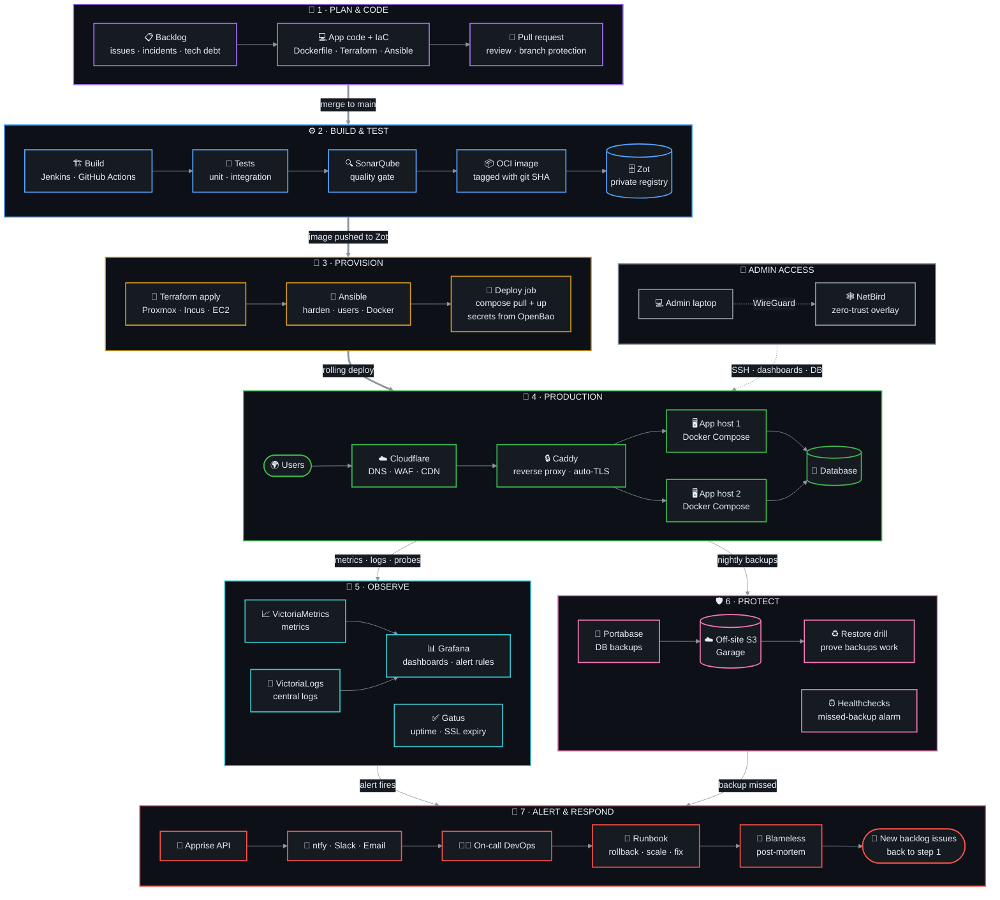
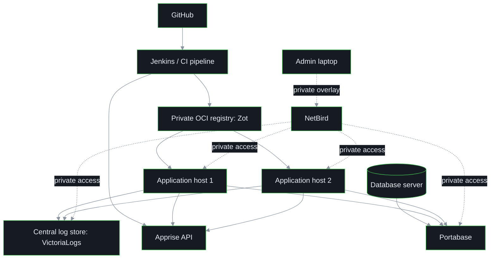

<!--
  GitHub profile README for Yash-xoxo
  ───────────────────────────────────
  1. Copy README.md, assets/ and .github/ into the repo github.com/Yash-xoxo/Yash-xoxo and push to main.
  2. The snake animation is generated by .github/workflows/snake.yml. It runs on every push,
     daily, and on demand (Actions tab → "Generate contribution snake" → Run workflow).
  3. Add LinkedIn / email in the "Connect" section at the bottom (currently commented out).
-->

<div align="center">


<a href="https://github.com/Yash-xoxo">
  
</a>

<p>
  
  <a href="https://github.com/Yash-xoxo?tab=followers"></a>
  
</p>



</div>


## 🧰 Tech stack

<div align="center">

&nbsp;
&nbsp;


<br/>

<br/>
<br/>


<br/>


</div>

| Area | What I actually do with it |
|---|---|
| 🐧 **Linux & virtualisation** | Proxmox VE on VMware Workstation · users and permissions · networking · systemd services |
| 🐳 **Containers** | Multi-service Docker Compose stacks · networks · volumes · health checks · env management |
| 🧱 **Infrastructure as Code** | Terraform-provisioned VMs · Ansible playbooks for repeatable configuration |
| 🔁 **CI/CD & quality** | Jenkins build → test → SonarQube pipelines · shell-based deploys · fixing broken credentials and SSH |
| ☁️ **Cloud & edge** | AWS EC2 · Cloudflare DNS · Caddy reverse proxy with automatic TLS |
| 🔭 **Operations** | Netdata · Dozzle · Portainer · reading logs · tracking down CPU, memory, disk and DB problems |


## ⚙️ How I ship



## 🗺️ The full flow a DevOps engineer owns

From an idea in the backlog to a healthy service in production — and back again when something breaks.
**Bold arrows** = the delivery path · **thin arrows** = the operations loop · **dotted** = private admin access.



<details>
<summary><b>🔎 Zoom in: reference architecture built from the underrated tools below</b></summary>
<br/>



</details>


## 🏗️ Featured projects

<table>
<tr>
<td width="50%" valign="top">

### ☁️ [NimbusOps Command Center](https://github.com/Yash-xoxo/cloud)
Python multi-cloud decision platform that simulates a production estate: incident blast radius, rollback priority, FinOps savings and compliance drift in one view.


</td>
<td width="50%" valign="top">

### 🔁 [CI/CD Pipelines](https://github.com/Yash-xoxo/CI-CD_Piplines)
Jenkins pipeline that builds, tests and containerises a Python app — Dockerfile, automated tests and pipeline run screenshots.


</td>
</tr>
<tr>
<td width="50%" valign="top">

### 🐳 [Docker Compose Server](https://github.com/Yash-xoxo/Docker-compose)
Travel site with a React frontend, a Node.js backend and MongoDB (seeded by an init script), wired together with Docker Compose.


</td>
<td width="50%" valign="top">

### 🐚 [Shell automation](https://github.com/Yash-xoxo/custom_script)
Bash scripts for everyday automation — WHOIS summary reports for domains, plus terminal games written to practise scripting.


</td>
</tr>
<tr>
<td width="50%" valign="top">

### 🧬 [Kernalx](https://github.com/Yash-xoxo/Kernalx)
My first kernel, written in Assembly over two iterations — learning how a machine boots, from the metal up.


</td>
<td width="50%" valign="top">

### 📚 [Internship notes](https://github.com/Yash-xoxo/Intern_notes)
Notes from my 2025 internship across DevOps, AI/ML and full-stack development.


</td>
</tr>
</table>


## 🧪 Underrated tools every DevOps engineer should know


Hand-picked from the **649 one-command installers** in [**community-scripts/Incus**](https://github.com/community-scripts/Incus)
(the same app scripts as the Proxmox VE Helper-Scripts, running on Incus).
Skip the obvious ones (Grafana, Jenkins, GitLab) — these are the tools that quietly solve real problems.

**⭐ If you only try five:** Beszel · Gatus · Dagu · Pangolin · Backrest

```bash
# On an Incus host: replace <app> with the name in the "Script" column
# (read a script before you pipe it to bash)
bash -c "$(curl -fsSL https://raw.githubusercontent.com/community-scripts/Incus/main/ct/<app>.sh)"
```

<br clear="right" />

<details open>
<summary><b>🔭 Observability & monitoring</b> — 9 tools</summary>
<br/>

| Tool | Why it's worth a look | Script |
|---|---|---|
| [**Beszel**](https://beszel.dev/) | Lightweight server and Docker stats with alerts — a hub plus tiny agents instead of a full Prometheus stack | `beszel` |
| [**Gatus**](https://github.com/TwiN/gatus) | Health checks *as code*: assert status, body, latency and cert expiry in YAML, and get a status page for free | `gatus` |
| [**VictoriaMetrics**](https://github.com/VictoriaMetrics/VictoriaMetrics) | Prometheus-compatible TSDB that needs far less RAM and disk — a drop-in remote-write target | `victoriametrics` |
| [**VictoriaLogs**](https://victoriametrics.com/products/victorialogs/) | Central logs without running ELK — fast LogsQL queries on modest hardware | `victorialogs` |
| [**OpenObserve**](https://openobserve.ai/) | Logs, metrics and traces in one binary, stored cheaply on object storage | `openobserve` |
| [**SigNoz**](https://signoz.io/) | OpenTelemetry-native APM — traces, metrics and logs in one UI; an open alternative to Datadog | `signoz` |
| [**Healthchecks**](https://healthchecks.io/) | Dead-man's switch for cron jobs and backups — alerts you when something *doesn't* run | `healthchecks` |
| [**PatchMon**](https://github.com/PatchMon/PatchMon) | Shows which Linux hosts are missing updates and automates patching across the fleet | `patchmon` |
| [**SmokePing**](https://oss.oetiker.ch/smokeping/) | Latency and packet-loss history that proves "it's the network" (or that it isn't) | `smokeping` |

</details>

<details>
<summary><b>🚀 CI/CD, Git & automation</b> — 9 tools</summary>
<br/>

| Tool | Why it's worth a look | Script |
|---|---|---|
| [**Forgejo + Runner**](https://forgejo.org/) | Self-hosted Git with a GitHub-Actions-compatible CI runner — own the whole pipeline | `forgejo` · `forgejo-runner` |
| [**OneDev**](https://onedev.io/) | Git server, CI/CD and issue boards in one app, with a GUI pipeline editor | `onedev` |
| [**Gitea Mirror**](https://github.com/RayLabsHQ/gitea-mirror) | Auto-syncs your GitHub repos to Gitea/Forgejo — a cheap off-GitHub backup of all your code | `gitea-mirror` |
| [**Dagu**](https://dagu.sh/) | Cron replacement: DAG workflows in YAML with retries, logs and a web UI | `dagu` |
| [**xyOps**](https://github.com/pixlcore/xyops) | The next generation of Cronicle: job scheduling, visual workflows, monitoring and incident response | `xyops` |
| [**Semaphore UI**](https://semaphoreui.com/) | Web UI for Ansible, Terraform/OpenTofu and scripts — RBAC, schedules and run history | `semaphore` |
| [**Komodo**](https://komo.do/) | Build and deploy Docker/Compose across many servers from one UI, synced from Git | `komodo` |
| [**Zot**](https://zotregistry.dev/) | Minimal OCI-native image registry with mirroring, signing and vulnerability-scanning extensions | `zot-registry` |
| [**Dockge**](https://dockge.kuma.pet/) | Compose-first stack manager — your `compose.yaml` files stay on disk, not locked in a database | `dockge` |

</details>

<details>
<summary><b>🌐 Networking, DNS & edge</b> — 9 tools</summary>
<br/>

| Tool | Why it's worth a look | Script |
|---|---|---|
| [**Pangolin + Newt**](https://pangolin.net/) | Self-hosted tunnelled reverse proxy with built-in auth — expose services without opening ports | `pangolin` · `newt` |
| [**NetBird**](https://netbird.io/) | WireGuard mesh VPN with SSO and access policies — private admin access to every host | `netbird` |
| [**Headscale**](https://github.com/juanfont/headscale) | Self-hosted Tailscale control server — keep the Tailscale clients, own the coordination | `headscale` |
| [**Technitium DNS**](https://technitium.com/dns/) | Recursive + authoritative DNS server with DoH/DoT, blocklists and a clean web UI | `technitiumdns` |
| [**Blocky**](https://0xerr0r.github.io/blocky) | DNS proxy and ad-blocker configured in one YAML file, with Prometheus metrics | `blocky` |
| [**Zoraxy**](https://zoraxy.aroz.org/) | Reverse proxy with a GUI: ACME certs, GeoIP blocking and a built-in uptime monitor | `zoraxy` |
| [**GoDoxy**](https://github.com/yusing/godoxy) | High-performance reverse proxy that configures routes automatically from your Docker containers | `godoxy` |
| [**Apt-Cacher NG**](https://wiki.debian.org/AptCacherNg) | Caches apt packages for the whole lab — faster provisioning and less bandwidth | `apt-cacher-ng` |
| [**netboot.xyz**](https://netboot.xyz) | PXE boot menu for dozens of OS installers and rescue tools over the network | `netboot-xyz` |

</details>

<details>
<summary><b>🔐 Security, identity & secrets</b> — 10 tools</summary>
<br/>

| Tool | Why it's worth a look | Script |
|---|---|---|
| [**OpenBao**](https://openbao.org/) | Open-source community fork of HashiCorp Vault — secrets, dynamic credentials and PKI | `openbao` |
| [**Infisical**](https://infisical.com/) | Secrets manager that syncs environment variables into CI/CD, Docker and Kubernetes | `infisical` |
| [**Pocket ID**](https://github.com/pocket-id/pocket-id) | Passkey-only OIDC provider — simple SSO for all your self-hosted apps | `pocketid` |
| [**Tinyauth**](https://github.com/tinyauthapp/tinyauth) | Tiny auth server that puts a login in front of any app behind your reverse proxy | `tinyauth` |
| [**LLDAP**](https://github.com/lldap/lldap) | Lightweight LDAP with a web UI — a user directory without the OpenLDAP pain | `lldap` |
| [**step-ca**](https://github.com/smallstep/certificates) | Private CA with an ACME server — real TLS (and SSH certificates) for internal services | `step-ca` |
| [**CertMate**](https://github.com/fabriziosalmi/certmate) | Control plane for TLS certs: issue, renew, inventory and deploy — ready for 47-day certificates | `certmate` |
| [**Teleport**](https://goteleport.com/) | Identity-based SSH, Kubernetes and database access with session recording | `teleport` |
| [**Wazuh**](https://wazuh.com/) | Open-source SIEM/XDR: file-integrity monitoring, vulnerability detection and compliance | `wazuh` |
| [**Yopass**](https://github.com/jhaals/yopass) | Share secrets through end-to-end encrypted, self-destructing links instead of chat | `yopass` |

</details>

<details>
<summary><b>🛠️ Developer & ops utilities</b> — 10 tools</summary>
<br/>

| Tool | Why it's worth a look | Script |
|---|---|---|
| [**IT-Tools**](https://it-tools.tech/) | Dozens of handy utilities: JWT decoder, crontab generator, chmod and subnet calculators, converters | `alpine-it-tools` |
| [**CyberChef**](https://github.com/gchq/CyberChef) | The "cyber Swiss Army knife" — chain decode, parse, hash and decrypt operations in the browser | `cyberchef` |
| [**OmniTools**](https://github.com/iib0011/omni-tools) | Self-hosted everyday tools for images, PDFs, text and JSON — no ads, no tracking | `omnitools` |
| [**Mailpit**](https://mailpit.axllent.org/) | Fake SMTP server with a web UI and API — test app and CI emails safely | `mailpit` |
| [**WhoDB**](https://whodb.com/) | Lightweight database explorer for Postgres, MySQL, SQLite, MongoDB, Redis and more | `whodb` |
| [**ChartDB**](https://github.com/chartdb/chartdb) | Visualise a database schema from a single query — instant ER diagrams | `chartdb` |
| [**Opengist**](https://opengist.io/) | Self-hosted, Git-backed gists for scripts and config snippets | `opengist` |
| [**Termix**](https://github.com/Termix-SSH/Termix) | Self-hosted, browser-based server management: SSH terminal, tunnels and file manager | `termix` |
| [**Web-Check**](https://github.com/Lissy93/web-check) | One-shot website analysis: DNS, TLS, headers, open ports, tech stack and more | `web-check` |
| [**Gotenberg**](https://github.com/gotenberg/gotenberg) | API that converts HTML, Markdown and Office documents to PDF — drop it into any pipeline | `gotenberg` |

</details>

<details>
<summary><b>💾 Storage & backups</b> — 9 tools</summary>
<br/>

| Tool | Why it's worth a look | Script |
|---|---|---|
| [**Garage**](https://garagehq.deuxfleurs.fr/) | Lightweight, geo-distributed S3 storage built for small clusters and home labs | `garage` |
| [**VersityGW**](https://github.com/versity/versitygw) | Serves an existing filesystem over the S3 API — no data migration needed | `versitygw` |
| [**SeaweedFS**](https://github.com/seaweedfs/seaweedfs) | Fast distributed storage for billions of files, with S3, FUSE and WebDAV | `seaweedfs` |
| [**Backrest**](https://garethgeorge.github.io/backrest/) | Web UI and scheduler for restic — browse snapshots and restore with a click | `backrest` |
| [**Zerobyte**](https://github.com/nicotsx/zerobyte) | Backup automation for self-hosters, built on restic | `zerobyte` |
| [**Portabase**](https://portabase.io) | One place to back up and restore PostgreSQL, MySQL, MariaDB, MongoDB, Redis, SQLite and more | `portabase` |
| [**Databasus**](https://github.com/databasus/databasus) | PostgreSQL backups with point-in-time recovery and *restore verification* | `databasus` |
| [**Borg UI**](https://github.com/karanhudia/borg-ui) | Create, schedule and restore Borg backups from a web UI instead of long terminal commands | `borg-ui` |
| [**Rclone**](https://github.com/rclone/rclone) | "rsync for cloud storage" — sync, mount and encrypt across dozens of providers | `rclone` |

</details>

<details>
<summary><b>🔔 Notifications & watchers</b> — 5 tools</summary>
<br/>

| Tool | Why it's worth a look | Script |
|---|---|---|
| [**Apprise API**](https://github.com/caronc/apprise-api) | One HTTP API that fans out to 100+ notification services (Slack, Telegram, email, ntfy…) | `apprise-api` |
| [**ntfy**](https://ntfy.sh/) | Push notifications from any script: `curl -d "backup done" ntfy.sh/your-topic` | `ntfy` |
| [**Gotify**](https://gotify.net/) | Self-hosted push server with a REST API and an Android app | `gotify` |
| [**Argus**](https://release-argus.io/) | Watches for new software releases and fires webhooks — a great trigger for upgrade pipelines | `argus` |
| [**Changedetection.io**](https://changedetection.io/) | Watches web pages and APIs for changes — vendor status pages, pricing, docs | `changedetection` |

</details>

<details>
<summary><b>🗺️ Infrastructure management & docs</b> — 8 tools</summary>
<br/>

| Tool | Why it's worth a look | Script |
|---|---|---|
| [**NetBox**](https://netboxlabs.com/) | Source of truth for IPs, racks, devices and circuits — feeds your automation | `netbox` |
| [**Scanopy**](https://github.com/scanopy/scanopy) | Network diagrams that update themselves | `scanopy` |
| [**Homelable**](https://github.com/Pouzor/homelable) | Interactive infrastructure diagram with live status monitoring | `homelable` |
| [**Rackula**](https://github.com/RackulaLives/Rackula) | Rack layout designer — plan the rack before you rack it | `rackula` |
| [**Cockpit**](https://github.com/cockpit-project/cockpit) | Web console for Linux servers: services, logs, storage, networking and updates | `cockpit` |
| [**PegaProx**](https://github.com/PegaProx/project-pegaprox) | Multi-cluster management for Proxmox VE and XCP-ng, with load balancing | `pegaprox` |
| [**Fleet**](https://github.com/fleetdm/fleet) | osquery-based visibility and device management for servers and laptops | `fleet` |
| [**Docmost**](https://docmost.com/) | Collaborative wiki (a Confluence alternative) — the perfect home for runbooks | `docmost` |

</details>

<details>
<summary><b>🤖 AI-assisted ops</b> — 3 tools</summary>
<br/>

| Tool | Why it's worth a look | Script |
|---|---|---|
| [**LiteLLM**](https://github.com/BerriAI/litellm) | One OpenAI-compatible gateway to 100+ LLM providers, with keys, budgets and logging | `litellm` |
| [**Ollama**](https://ollama.com/) + [**Open WebUI**](https://github.com/open-webui/open-webui) | Run local LLMs behind a ChatGPT-style UI — private AI for logs and docs | `ollama` · `openwebui` |
| [**n8n**](https://n8n.io/) | Visual workflow automation with AI nodes — glue alerts, tickets and chat together | `n8n` |

</details>

<sub>Full catalogue with ready-made commands: <a href="https://community-scripts.org">community-scripts.org</a></sub>


## 🤝 Connect

<div align="center">

<a href="https://github.com/Yash-xoxo"></a>
<!-- Uncomment and fill in:
<a href="https://www.linkedin.com/in/YOUR-HANDLE/"></a>
<a href="mailto:YOU@EXAMPLE.COM"></a>
-->

<br/><br/>

<i>Automate the repeatable · Observe the important · Keep improving</i>


</div>
